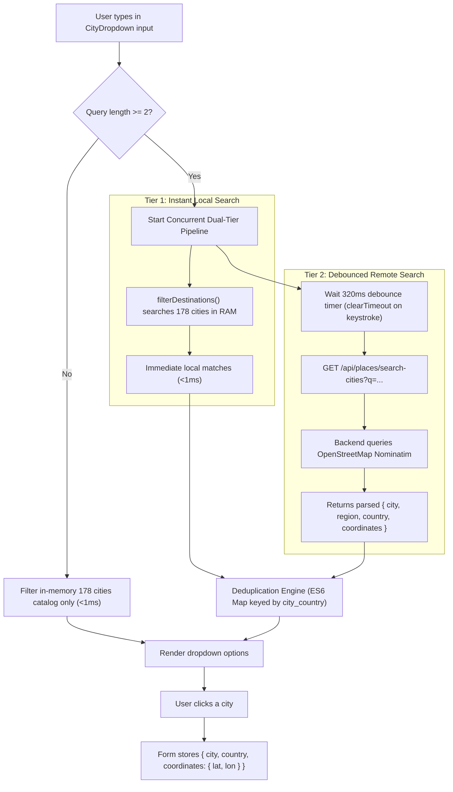
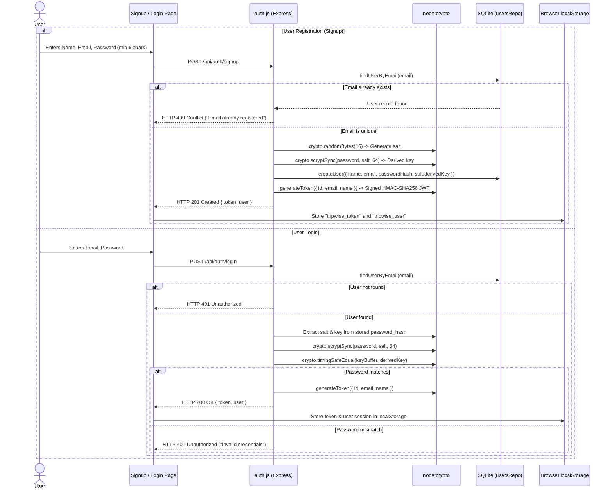
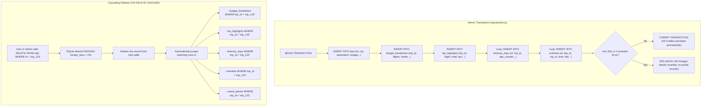

# TripWise AI — System Flowcharts & Sequence Diagrams

This document visualizes the complete architectural flows of TripWise AI using Mermaid diagrams. Each diagram is accompanied by a step-by-step technical explanation.

---

## 1. Application Startup & Initialization Flow

```mermaid
flowchart TD
    subgraph Frontend_Startup["Frontend Startup (Vite Dev Server :5173)"]
        A1["Browser requests http://localhost:5173"] --> A2["index.html loaded with &lt;div id='root'&gt;"]
        A2 --> A3["src/main.jsx executes ReactDOM.createRoot()"]
        A3 --> A4["&lt;App /&gt; mounts inside &lt;BrowserRouter&gt;"]
        A4 --> A5["React Router DOM registers paths: /, /generate-trip, /trip-details, etc."]
        A5 --> A6["Initial route / renders &lt;Home /&gt; page"]
    end

    subgraph Backend_Startup["Backend Startup (Express Server :5001)"]
        B1["Terminal executes node src/index.js"] --> B2["dotenv loads .env variables into process.env"]
        B2 --> B3["db/database.js initializes new DatabaseSync('tripwise.db')"]
        B3 --> B4["Executes PRAGMA foreign_keys = ON & journal_mode = WAL"]
        B4 --> B5["db/schema.js executes initSchema(): creates 7 tables & indexes"]
        B5 --> B6["Registers middleware: cors(), express.json(), logger"]
        B6 --> B7["Mounts API routers: /api/auth, /api/trips, /api/weather, etc."]
        B7 --> B8["app.listen(5001) starts listening on port 5001"]
    end
```



### Explanation:
- **Frontend:** Vite serves ES modules directly to the browser. React mounts into the `#root` container, initializes routing, and renders the `<Home />` page.
- **Backend:** Express imports `node:sqlite`, connects to `tripwise.db`, enables Write-Ahead Logging (`WAL`), and verifies table schemas before listening on port 5001.

---

## 2. End-to-End Trip Generation Sequence

```mermaid
sequenceDiagram
    autonumber
    actor User as Traveler
    participant Form as Form.jsx (React)
    participant API as api.js (Client)
    participant Server as Express (trips.js)
    participant Gemini as Gemini AI Service
    participant Unsplash as Image Service
    participant DB as SQLite (repositories.js)
    participant Details as TripDetails.jsx

    User->>Form: Enters origin, destination, budget, duration, styles
    User->>Form: Clicks "Generate Trip"
    Form->>Form: Executes validation (budget > 0, duration 1-30, styles >= 1)
    Form->>API: generateTrip(formData)
    API->>Server: POST /api/trips/generate
    
    par Parallel Operations
        Server->>Gemini: generateItinerary(destination, duration, budget, styles)
        Gemini-->>Server: Returns structured non-repeating JSON days
    and
        Server->>Unsplash: fetchDestinationImage(destination)
        Unsplash-->>Server: Returns high-res cover image URL
    end

    Server->>DB: tripsRepo.saveTrip(tripRecord)
    Note over DB: Atomic Transaction: BEGIN TRANSACTION<br/>Inserts into trips, days, activities, budget, highlights<br/>COMMIT TRANSACTION
    DB-->>Server: Returns saved trip object with ID (trip_1741...)
    Server-->>API: HTTP 201 Created { success: true, data: savedTrip }
    API-->>Form: Resolves promise with response
    Form->>Details: navigate('/trip-details?id=' + trip_1741...)
    Details->>User: Displays interactive itinerary, map, charts & weather
```

---

## 3. Dual-Tier City Search & Geocoding Flow



---

## 4. User Authentication & Session Security Flow



---

## 5. Database Persistence & Foreign Key Cascade Flow


